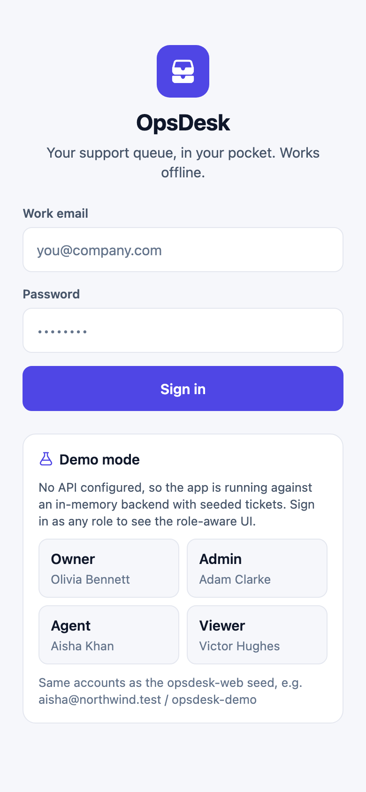
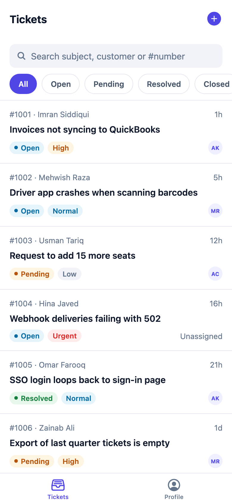
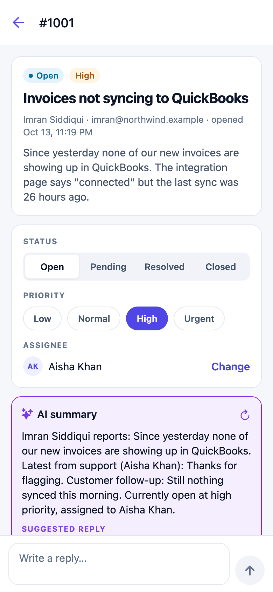
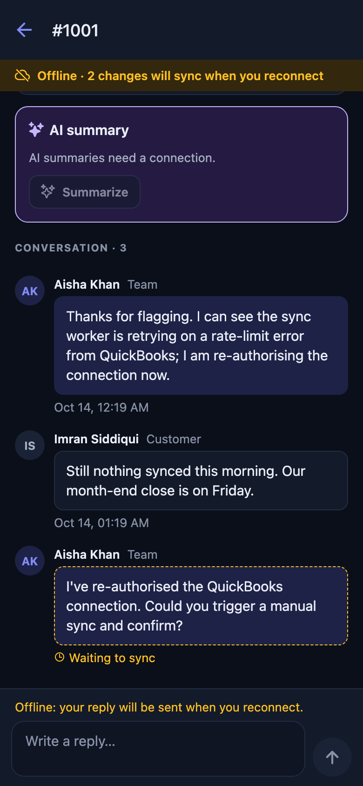
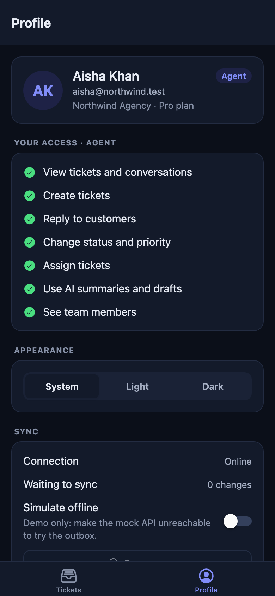
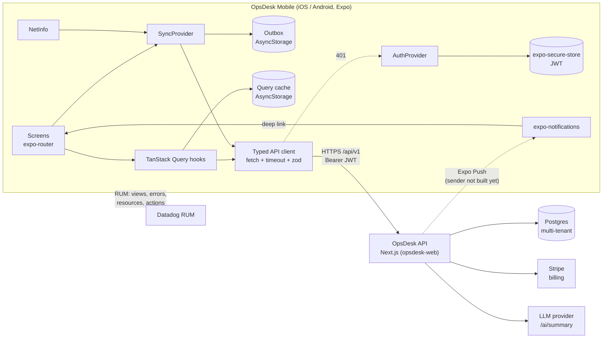

# OpsDesk Mobile

[](https://github.com/ranazaid/opsdesk-mobile/actions/workflows/ci.yml)
[](https://github.com/ranazaid/opsdesk-mobile/actions/workflows/security.yml)


**An offline-first iOS and Android app for support agents, built with React Native, Expo and TypeScript.**

OpsDesk Mobile is the companion app for **OpsDesk**, a multi-tenant support-ticket SaaS. The web app and REST API live in **[ranazaid/opsdesk-web](https://github.com/ranazaid/opsdesk-web)**. With this app, agents can triage their queue, reply to customers and change ticket status from their phone, including on a train with no signal. Writes made offline are queued, shown straight away and replayed in order when the connection returns.

Point `EXPO_PUBLIC_API_URL` at an opsdesk-web instance and the app talks to its `/api/v1` REST API. Leave it unset and the app runs in **demo mode** against an in-memory backend that mirrors that API, with the same demo accounts, RBAC rules and error codes as the opsdesk-web seed. That way you can explore every role in Expo Go without a server. A contract test runs the real HTTP adapter against a live opsdesk-web to keep the two repos in step.

> **Portfolio reference implementation:** patterns from production apps I've shipped to the App Store and Play Store, rebuilt from scratch with demo data.

| Sign in (demo mode) | Ticket queue | Ticket + AI summary | Offline reply (dark) | Role & settings (dark) |
| :---: | :---: | :---: | :---: | :---: |
|  |  |  |  |  |

<sub>I captured these screenshots from the web target (`npx expo start --web`) at phone width in demo mode. The iOS and Android builds render the same React Native UI.</sub>

---

## Features

- **Ticket queue:** debounced search (subject, customer, `#number`), status filter chips (open, pending, resolved, closed), page-based infinite scroll and pull-to-refresh. Pull-to-refresh also flushes the outbox.
- **Ticket detail:**
  - The full thread, with customer messages, team replies and internal notes styled differently.
  - A reply composer.
  - Status, priority and assignee controls, each shown or hidden by the RBAC matrix shared with opsdesk-web.
- **AI summary card:** calls `POST /ai/summary` for the `summary` and `reply` tasks in parallel. It shows a short summary plus a suggested reply, and *Use as reply* drops the suggestion into the composer.
- **Create ticket:** form validated with zod, with clear messaging when you're offline.
- **Profile & settings:** your role and what it allows, a System/Light/Dark theme picker, sync status, push status, and sign out.
- **Offline-first:**
  - Comments and status/priority/assignee changes go through a persisted **outbox**.
  - The UI updates optimistically.
  - The outbox replays on reconnect, on app foreground and when backoff expires.
  - The query cache is persisted, so the queue opens instantly, even with no connection.
- **Auth:**
  - The JWT is stored in `expo-secure-store` (Keychain/Keystore).
  - The session is restored on launch and revalidated with `GET /me`.
  - Any `401` signs the user out automatically.
- **Role-aware UI:** a single permission matrix shared with the web app.
- **Push notifications:** handles permissions, sets up the Android channel and registers an Expo push token with the backend. Tapping a notification opens the ticket.
- **Datadog RUM:** errors, resources, interactions and route-based views. It only switches on when credentials are configured.
- **Light and dark themes:** built from semantic design tokens, with accessibility roles, labels and states on interactive components.

## Architecture



If `EXPO_PUBLIC_API_URL` is empty, `src/api/index.ts` swaps the HTTP client for `createMockApi()`. Both implement the same `OpsDeskApi` interface and validate responses against the same zod schemas, so the rest of the app can't tell them apart.

### Project layout

```
src/
  app/            expo-router routes (thin: they render feature screens)
  api/            zod schemas, HTTP client, OpsDeskApi, mock backend + seed data
  auth/           AuthProvider, secure token storage, session + 401 signal
  offline/        Outbox, SyncProvider, optimistic overlay, NetInfo status
  features/       tickets (list/detail/create + hooks), auth (login), settings
  permissions/    shared role permission matrix
  notifications/  push registration + notification deep links
  monitoring/     monitoring.ts: Datadog RUM wrapper
  components/     UI kit + ticket components
  theme/          design tokens, ThemeProvider (System/Light/Dark)
```

## Tech stack

| Area | Choice |
| --- | --- |
| Framework | Expo SDK 57, React Native 0.86, React 19 |
| Language | TypeScript (`strict`, `noUncheckedIndexedAccess`) |
| Navigation | expo-router (file-based, `Stack.Protected` auth gating, `opsdesk://` deep links) |
| Server state | TanStack Query v5 + AsyncStorage persister |
| Validation | zod 4 (API responses and form input) |
| Offline | Custom outbox on AsyncStorage + `@react-native-community/netinfo` |
| Auth storage | `expo-secure-store` |
| Push | `expo-notifications`, `expo-device` |
| Monitoring | `@datadog/mobile-react-native` (RUM) |
| Testing | Jest (`jest-expo`) + React Native Testing Library 14 |
| Tooling | ESLint (`eslint-config-expo`), `tsc --noEmit`, GitHub Actions, Snyk, Dependabot, EAS Build |

## API contract (opsdesk-web `/api/v1`)

The app consumes the REST API that [opsdesk-web](https://github.com/ranazaid/opsdesk-web) serves under `${EXPO_PUBLIC_API_URL}/api/v1`. Every request except login sends `Authorization: Bearer <accessToken>`.

Two files own the mapping between the server's wire format and the app's domain types:

- [`src/api/schemas.ts`](src/api/schemas.ts) holds the zod wire and domain schemas.
- [`src/api/httpApi.ts`](src/api/httpApi.ts) is the adapter.

Nothing else in the app knows about response envelopes.

| Method | Path | Response | Used for |
| --- | --- | --- | --- |
| `POST` | `/auth/login` | `{ accessToken, tokenType, expiresIn, user, organization: { id, name, plan, role } }` | Sign-in (mapped to the session user) |
| `GET` | `/me` | `{ user, organization, role, permissions }` | Revalidating a restored session |
| `GET` | `/tickets?status=&q=&page=&pageSize=` | `{ items, total, page, pageSize }` | Queue, search, filters, infinite scroll |
| `GET` | `/tickets/:id` | `{ ticket }` | Ticket detail (fetched in parallel with the thread) |
| `GET` | `/tickets/:id/comments` | `{ comments }` | Thread, including internal notes |
| `POST` | `/tickets` | `{ ticket }` (201) | Create ticket |
| `PATCH` | `/tickets/:id` | `{ ticket }` | Status, priority, assignee (outbox) |
| `POST` | `/tickets/:id/comments` | `{ comment }` (201), body `{ body, isInternal: false }` | Replies (outbox) |
| `POST` | `/ai/summary` | `{ task, text, provider, model }`, body `{ ticketId, task }` | AI card (`summary` + `reply`) |
| `GET` | `/members` | `{ members: [{ userId, name, email, role, joinedAt }] }` | Assignee picker |
| `POST` | `/devices/push-token` | `{ ok: true }`, body `{ token, platform }` | Push registration (upsert) |

The enums match opsdesk-web's `src/lib/domain.ts`:

- roles: `owner | admin | agent | viewer`
- statuses: `open | pending | resolved | closed`
- priorities: `low | normal | high | urgent`

**Errors.** Errors from the server arrive as `{ error: { code, message, details? } }`, with these statuses: 401 unauthorized, 403 forbidden, 404 not found, 422 validation_failed, 402 plan limit and 429 rate limited. The client normalises them into a single `ApiError` with one of five kinds: `network`, `timeout`, `unauthorized`, `http` or `validation`. Each error also carries a `retryable` flag, which both the TanStack retry policy and the outbox use. Any 401 outside login signs the user out.

**Contract test.** [`src/api/__tests__/opsdeskWeb.e2e.test.ts`](src/api/__tests__/opsdeskWeb.e2e.test.ts) drives the real HTTP adapter against a running opsdesk-web through this sequence:

1. login → `/me`
2. paged list → detail + thread
3. reply → status/priority change
4. AI summary
5. members → reassign
6. push-token registration → ticket creation
7. 401 and 403 handling

See [Testing](#testing).

## Offline queue design

The app is **outbox-first**: comments and ticket updates always go through the queue, whether you're online or offline. That keeps a single code path for both cases.

```
user action ──► outbox.enqueue(op) ──► persisted to AsyncStorage
                     │
                     ├─► UI renders  server data + pending ops  (optimistic overlay)
                     │
                     └─► online? replay now : wait for NetInfo / foreground / backoff timer
                                   │
             executor(op) ──► API ──► write confirmed entity into query cache ──► dequeue
```

- **Strict FIFO and single-flight:**
  - The head entry must finish before the next one is sent, so the server sees writes in the order the user made them.
  - If a NetInfo event and a pull-to-refresh both trigger a replay, they share one run.
- **Retryable failures** (network, timeout, 408/429/5xx):
  - The entry stays at the head of the queue.
  - `attempts` is incremented and capped exponential backoff is scheduled.
  - After `maxAttempts`, the entry is dropped and reported.
  - When connectivity returns, the backoff timer is skipped and the queue flushes immediately.
- **Permanent failures** (400/403/404/409/validation), for example a role change while offline:
  - The entry is dropped immediately, so it can't block the queue.
  - The user sees a dismissible banner.
  - The error is sent to Datadog.
- **Coalescing:** repeated updates to the same ticket are merged into the queued entry (last write wins per field). An entry that is in flight is never changed.
- **At-least-once delivery:** an entry leaves the queue only after the server confirms it. Each comment carries a client-generated id that keys its optimistic copy in the UI until the server's version replaces it.
- **Optimistic overlay, not cache surgery:** screens render `server data + pending ops` (`src/offline/pending.ts`), so a refetch or an app restart can't wipe pending changes.
- **Durability:**
  - Each change is persisted before it is acknowledged, and storage writes are serialised.
  - Corrupt persisted data is discarded instead of crashing the app.
  - On a cold start, the queue is hydrated before replay.
  - The queue is cleared on sign-out.
- **Online-only actions:** creating a ticket (the server assigns the ticket number) and AI summaries are disabled while offline, with an explanation.

In demo mode, **Profile → Simulate offline** makes the mock API unreachable. This exercises the same queue path as a real outage, without toggling airplane mode.

## Role matrix

[`src/permissions/matrix.ts`](src/permissions/matrix.ts) mirrors opsdesk-web's single source of truth, [`src/lib/permissions.ts`](https://github.com/ranazaid/opsdesk-web/blob/main/src/lib/permissions.ts). It uses the same permission names (`ticket:update`, `ticket:assign`, `comment:create`, `ai:use`, ...) and the same role sets, and its tests pin the same table as the web app's `rbac.test.ts`. The server enforces the matrix on every request, the app uses it to decide which controls to show, and the demo backend enforces it too.

| Capability (permission) | Owner | Admin | Agent | Viewer |
| --- | :---: | :---: | :---: | :---: |
| View tickets and threads (`ticket:read`) | ✅ | ✅ | ✅ | ✅ |
| Create tickets (`ticket:create`) | ✅ | ✅ | ✅ | ❌ |
| Reply (`comment:create`) | ✅ | ✅ | ✅ | ❌ |
| Change status / priority (`ticket:update`) | ✅ | ✅ | ✅ | ❌ |
| Assign / reassign (`ticket:assign`) | ✅ | ✅ | ✅ | ❌ |
| AI summary and draft (`ai:use`) | ✅ | ✅ | ✅ | ❌ |
| See team members (`member:read`) | ✅ | ✅ | ✅ | ✅ |

Member management (owner and admin) and billing (owner manages, admin reads) live in the web app only.

Viewers get a read-only ticket view with no composer and no controls. The assignee picker only offers roles that can work tickets, because the server rejects assigning to viewers.

## Run locally

Requirements: Node 22.13 or newer, and npm.

```bash
npm i
npx expo start
```

Then scan the QR code with **Expo Go** (iOS or Android), or press `i` / `a` / `w` for the iOS simulator, an Android emulator or the web.

**Demo mode** is the default, because `EXPO_PUBLIC_API_URL` is unset:

- Tap **Owner / Admin / Agent / Viewer** on the sign-in screen, or sign in with `aisha@northwind.test` / `opsdesk-demo`. These are the same accounts as the opsdesk-web seed.
- Try the role-aware UI.
- Turn on **Profile → Simulate offline**, reply to a ticket and change its status, then turn it off and watch the changes sync.

To run against a real OpsDesk backend, start [opsdesk-web](https://github.com/ranazaid/opsdesk-web) locally. It uses an embedded PGlite database, so it needs no Postgres or Docker:

```bash
# in opsdesk-web
npm i && npm run db:seed && npm run dev      # http://localhost:3000

# in opsdesk-mobile
cp .env.example .env
# EXPO_PUBLIC_API_URL=http://<your-LAN-IP>:3000   (a phone can't reach "localhost" on your computer)
npx expo start --clear
```

All variables are documented in [`.env.example`](.env.example).

### Native builds (EAS)

Datadog RUM and remote push need a native build. Neither is available in Expo Go: Expo removed Android remote push from Expo Go in SDK 53, and the Datadog native SDK isn't bundled with Expo Go.

```bash
npx eas-cli@latest init                          # sets the EAS project id (use as EAS_PROJECT_ID)
npx eas-cli@latest build --profile development   # internal debug build (iOS simulator / Android APK)
npx eas-cli@latest build --profile preview       # internal release build for testers
npx eas-cli@latest build --profile production    # store build, auto-incremented version
```

`app.config.ts` reads `APP_VARIANT` from the profile, so the dev, preview and production builds get separate bundle IDs and app names and can be installed side by side.

### Push notifications

After sign-in on a physical device, the app:

1. Asks for notification permission.
2. Creates the Android `ticket-updates` channel.
3. Gets an Expo push token.
4. Registers the token with `POST /api/v1/devices/push-token`, sending `{ token: "ExponentPushToken[...]", platform: "ios" | "android" }`.

To deep-link to a ticket, the server sends either `data: { ticketId: "tkt_123" }` or `data: { url: "opsdesk://tickets/tkt_123" }`. Taps are routed to `/tickets/:id`, including the tap that launched the app from a killed state. Payloads that don't match a strict ticket-id pattern are ignored. Sending pushes is server-side work and out of scope for this repo.

### Monitoring (Datadog RUM)

To turn on monitoring, set `EXPO_PUBLIC_DD_CLIENT_TOKEN` and `EXPO_PUBLIC_DD_APPLICATION_ID`, and optionally `EXPO_PUBLIC_DD_SITE` and `EXPO_PUBLIC_DD_ENV`. Monitoring then initialises with:

- JS error and native crash tracking
- resource and interaction tracking
- trace-header propagation to the API host
- user context: id, role and org

Views are tracked from the expo-router pathname, with dynamic segments collapsed (for example, `/tickets/[id]`).

All of this sits behind [`src/monitoring/monitoring.ts`](src/monitoring/monitoring.ts). Without credentials, on web, or in Expo Go, every call is a no-op.

## Testing

```bash
npm test             # jest (jest-expo preset)
npm run test:ci      # with coverage
npm run lint         # eslint, zero warnings allowed
npm run typecheck    # tsc --noEmit
npm run verify       # all of the above
```

Jest runs **98 tests in 10 suites**, plus **3 contract tests against a live opsdesk-web** that are skipped unless you point them at a server:

| Suite | What it proves |
| --- | --- |
| `permissions/matrix` | The matrix is identical to opsdesk-web's (same lists per role), strictly hierarchical, viewers read-only, only non-viewers assignable, PATCH-level guards |
| `offline/outbox` | Persistence across "restarts", corrupt-data recovery, FIFO replay, stop-on-retryable with backoff, max attempts, dropping permanent failures, single-flight, coalescing (never into the in-flight entry), optimistic overlay |
| `api/httpClient` | Bearer header, **401 → `unauthorized` + logout hook** (but not for login), **zod validation failure → `validation` error**, error envelopes, network/timeout mapping, and the opsdesk-web adapter: login mapping, `{ ticket }`/`{ comment }`/`{ members }` unwrapping, page/pageSize query, detail + thread merge, AI summary + reply |
| `api/mockApi` | Same demo accounts as the web seed, 401s, page/pageSize/total pagination, filters and search, 403/422 like the server, customer/internal thread, ticket creation, AI summary, members, simulated offline |
| `auth/AuthProvider` | Sign-in stores the token in secure storage, session restore, **automatic logout on 401** that clears storage and per-user data, manual sign-out |
| `TicketListScreen` | **Renders tickets, filters by status chip**, debounced search plus empty state, infinite scroll, navigation, an offline status change leaving the filtered list |
| `TicketDetailScreen` | Role-aware UI (viewer read-only, agent reassigns, admin unassigns); offline reply shown as pending and synced on reconnect; optimistic status change; AI summary used as a reply; replay of a queue persisted before an app restart |
| `notifications/deepLink`, `monitoring`, `utils/time` | Push payload → route (rejects unsafe ids and foreign URLs), monitoring no-ops when disabled, relative time formatting |
| `api/opsdeskWeb.e2e` (opt-in) | The real HTTP adapter against a running opsdesk-web: the full agent flow, viewer 403, bad-token 401, bad-credentials login |

Screen tests render the real provider stack (theme, API, query client, auth, sync) against the mock backend. They don't use snapshots.

To run the contract tests against a live server:

```bash
# in opsdesk-web:    npm run db:seed && npm run dev
OPSDESK_E2E_URL=http://localhost:3000 npm run test:e2e
```

## CI

- **[`ci.yml`](.github/workflows/ci.yml)** runs on every push and PR. It does `npm ci`, then lint, typecheck and Jest with coverage, then a web bundle smoke test (`expo export --platform web`).
- **[`security.yml`](.github/workflows/security.yml)** runs a Snyk dependency scan (`snyk/actions/node`) on every push and PR, and weekly. It needs the `SNYK_TOKEN` repository secret and is report-only (`continue-on-error: true`) until a baseline has been triaged.
- **[Dependabot](.github/dependabot.yml)** opens weekly npm and GitHub Actions updates. Expo SDK packages are grouped so they move together, and major Expo upgrades are left for a human to do.

## Known limitations

- **Creating tickets needs a connection.** Ticket numbers come from the server, so offline creation would need temporary IDs and remapping. That's deliberately out of scope.
- **Demo mode data is in-memory.** It resets on reload. The outbox and query cache are still persisted, so the offline flows behave the same.
- **On web, the session uses `sessionStorage`.** `expo-secure-store` has no web implementation. The web target is only used for previews and screenshots; iOS and Android use the Keychain/Keystore.
- **Comment replays are at-least-once.** `POST /tickets/:id/comments` doesn't take an idempotency key yet. If the server stores a reply but the response is lost, the replay can post it twice.
- **Push sending is server-side and not built.** The app registers tokens with opsdesk-web, but the sender isn't part of either repo yet.

## License

[MIT](LICENSE) © 2026 Zaid Mubbashar
